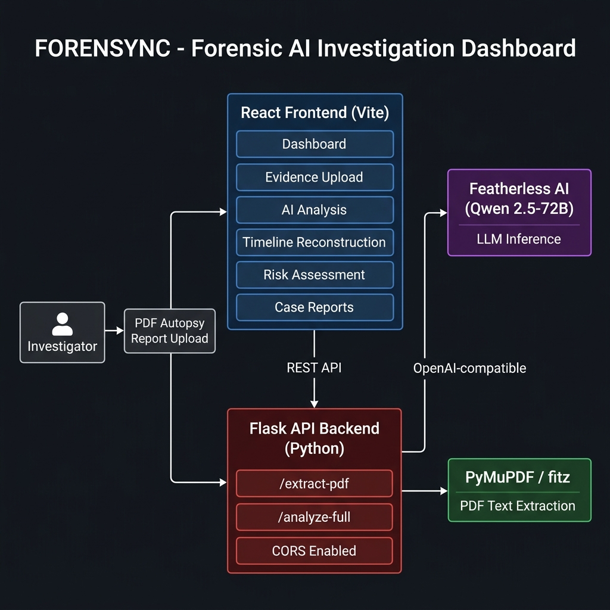
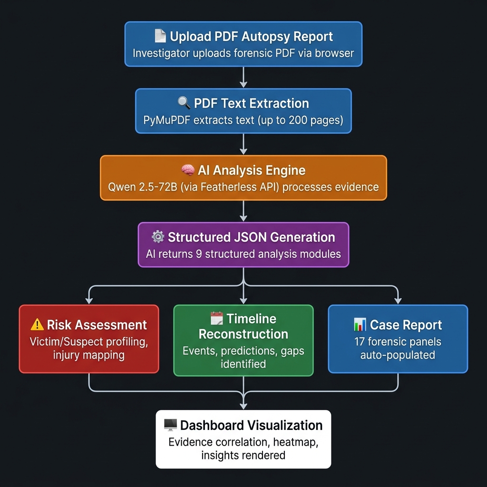
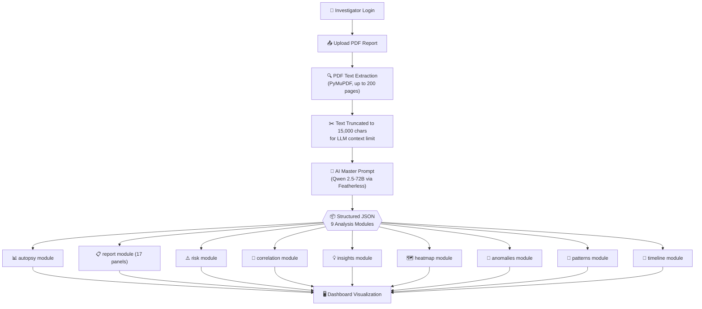

# 🔍 FORENSYNC — AI-Powered Forensic Investigation Dashboard

> *Transforming raw forensic evidence into structured intelligence — instantly.*

[](https://www.python.org/)
[](https://react.dev/)
[](https://flask.palletsprojects.com/)
[](https://vite.dev/)
[](LICENSE)

---

## 👥 Team Details

| Role | Name |
|------|------|
| Team Name | **ForenSyncAI** |
| GitHub | [@rounithrathesh-coder](https://github.com/rounithrathesh-coder) |
| Repository | [ForenSyncAI](https://github.com/rounithrathesh-coder/ForenSyncAI) |

---

## 🚨 Problem Statement

Forensic investigators and medical examiners face an enormous challenge: **autopsy reports, crime scene documents, and forensic evidence are dense, unstructured, and time-consuming to analyze manually.** This leads to:

- ⏳ Days spent manually reading and cross-referencing lengthy PDF reports
- 🧩 Difficulty correlating evidence from multiple sources
- 📉 Risk of overlooking critical inconsistencies or patterns
- 📋 Tedious, error-prone manual report generation

### ✅ Our Solution

**FORENSYNC** is an AI-powered forensic intelligence dashboard that:
- **Automatically parses** raw PDF autopsy/forensic reports
- **Extracts and structures** critical data using a 72B-parameter LLM
- **Visualizes** findings across 9 intelligent analysis modules
- **Reduces investigation time** from days to minutes

---

## ✨ Features

| Feature | Description |
|---------|-------------|
| 📄 **PDF Evidence Upload** | Drag-and-drop forensic PDF ingestion (up to 200 pages) |
| 🧠 **AI Autopsy Analysis** | Cause of death, time of death, injury patterns, suspicious indicators |
| 📅 **Timeline Reconstruction** | AI-generated chronological event mapping with confidence scores |
| ⚠️ **Risk Assessment** | Victim/suspect profiling, anatomical injury overlay, threat vectors |
| 🔗 **Evidence Correlation** | Visual node-graph linking suspects, victims, evidence, and locations |
| 📊 **Case Reports** | 17-panel auto-generated forensic report |
| 🗺️ **Case Heatmap** | Spatial visualization of forensic activity hotspots |
| 🔍 **AI Insights** | Critical, warning, and informational insight cards |
| 🔐 **Secure Login** | Authentication gate before accessing sensitive data |

---

## 🛠️ Tech Stack

### Frontend

| Technology | Version | Purpose |
|-----------|---------|---------|
| React | 18.3.1 | UI Framework |
| TypeScript | — | Type Safety |
| Vite | 6.3.5 | Build Tool & Dev Server |
| Tailwind CSS | 4.1.12 | Utility-first Styling |
| Radix UI | Latest | Accessible UI Primitives |
| Recharts | 2.15.2 | Data Visualization / Charts |
| Lucide React | 0.487.0 | Icon Library |
| Motion | 12.23.24 | Animations |
| React Router | 7.13.0 | Client-side Routing |
| MUI | 7.3.5 | Material UI Components |

### Backend

| Technology | Version | Purpose |
|-----------|---------|---------|
| Python | 3.8+ | Runtime |
| Flask | 2.3.3 | REST API Framework |
| Flask-CORS | 4.0.0 | Cross-Origin Requests |
| PyMuPDF (fitz) | 1.24.2 | PDF Text Extraction |
| OpenAI SDK | 2.x | API Client for Featherless AI |
| python-dotenv | 1.0.0 | Environment Variable Management |

### AI / ML

| Component | Details |
|-----------|---------|
| **LLM Model** | Qwen/Qwen2.5-72B-Instruct |
| **Provider** | [Featherless.ai](https://featherless.ai) (OpenAI-compatible API) |
| **Inference Type** | Hosted serverless inference |
| **Concurrency Control** | Threading semaphore (max 2 parallel AI requests) |
| **Retry Logic** | Exponential back-off for 429/502/504 errors |

---

## 🏗️ System Architecture



### Architecture Overview

```
┌─────────────┐      ┌──────────────────────┐      ┌──────────────────┐
│ Investigator │─────▶│  React Frontend      │─────▶│  Flask Backend   │
│  (Browser)  │      │  (Vite + TypeScript) │      │  (Python)        │
└─────────────┘      └──────────────────────┘      └────────┬─────────┘
                                                             │
                  ┌──────────────────────────────────────────┼────────────────────┐
                  ▼                                          ▼                    ▼
        ┌──────────────────┐                  ┌─────────────────────┐  ┌─────────────────┐
        │  PyMuPDF (fitz)  │                  │  Featherless AI     │  │  JSON Response  │
        │  PDF Extraction  │                  │  Qwen2.5-72B        │  │  (9 modules)    │
        └──────────────────┘                  └─────────────────────┘  └─────────────────┘
```

**Data Flow:**
1. Investigator uploads a PDF via the React browser app
2. Frontend sends the file via `multipart/form-data` POST to Flask
3. Flask uses PyMuPDF to extract text from up to 200 pages
4. Extracted text is sent (up to 15,000 chars) to Featherless AI
5. The LLM returns a single comprehensive structured JSON
6. Flask parses and relays the JSON to the frontend
7. React renders visualizations across 6 dashboard pages

---

## 🔄 Detailed Workflow



### Step-by-Step Flow



### AI Analysis Modules Explained

| Module | Output |
|--------|--------|
| `autopsy` | Cause of death, TOD, BAC, rigor/livor mortis, suspicious indicators |
| `report` | 17-panel formal forensic report (case ID, victim details, scene, toxicology, etc.) |
| `risk` | Risk scores, victim/suspect profiles, anatomical injury map, threat vectors |
| `correlation` | Node-edge evidence graph (suspects ↔ victims ↔ locations ↔ evidence) |
| `insights` | Prioritized critical/warning/info findings |
| `heatmap` | Spatial hotspot coordinates with severity labels |
| `anomalies` | Flagged inconsistencies with severity scores |
| `patterns` | Wound patterns, behavioral patterns with confidence levels |
| `timeline` | Chronological event list with AI predictions and gap detection |

---

## 📁 Folder Structure

```
ForenSyncAI/
├── README.md                    # This file
├── requirements.txt             # Python dependencies
├── package-lock.json            # Root lock file
├── docs/                        # Documentation assets
│   ├── architecture_diagram.png
│   └── workflow_diagram.png
│
├── backend/
│   ├── app.py                   # Flask REST API (main entry point)
│   ├── API.env                  # Environment variables (NOT committed)
│   └── API.env.example          # Template for API.env
│
└── frontend/
    ├── index.html               # App entry HTML
    ├── package.json             # Node dependencies
    ├── vite.config.ts           # Vite configuration
    ├── postcss.config.mjs       # PostCSS / Tailwind config
    ├── default_shadcn_theme.css # Base theme
    └── src/
        ├── main.tsx             # React root
        ├── styles/              # Global styles
        └── app/
            ├── App.tsx          # Root component (routing + auth gate)
            └── components/
                ├── LoginPage.tsx
                ├── Sidebar.tsx
                ├── TopBar.tsx
                ├── CaseOverviewCards.tsx
                ├── AIAutopsyPanel.tsx
                ├── AIInsightsPanel.tsx
                ├── EvidenceTimeline.tsx
                ├── EvidenceCorrelation.tsx
                ├── RiskScorePanel.tsx
                ├── CaseHeatmap.tsx
                ├── ActivityLog.tsx
                ├── FileUploadSection.tsx
                ├── EvidenceUploadPage.tsx
                ├── AIAnalysisPage.tsx
                ├── TimelineReconstructionPage.tsx
                ├── CaseReportsPage.tsx
                └── RiskAssessmentPage.tsx
```

---

## ⚙️ Installation & Usage Guide

### Prerequisites

| Requirement | Version |
|------------|---------|
| Node.js | v18+ |
| Python | 3.8+ |
| Featherless.ai API Key | [Get one here](https://featherless.ai) |

---

### 🐍 Backend Setup

```bash
# 1. Clone the repository
git clone https://github.com/rounithrathesh-coder/ForenSyncAI.git
cd ForenSyncAI

# 2. Create a Python virtual environment
python3 -m venv venv
source venv/bin/activate       # Windows: venv\Scripts\activate

# 3. Install Python dependencies
pip install -r requirements.txt

# 4. Configure your API key
cp backend/API.env.example backend/API.env
# Open backend/API.env and insert your key:
# FEATHERLESS_API_KEY=your_actual_api_key_here

# 5. Start the Flask backend
python backend/app.py
# → API listening at http://127.0.0.1:5000
```

---

### ⚛️ Frontend Setup

```bash
# (In a new terminal, from the project root)
cd frontend

# Install Node dependencies
npm install

# Launch the development server
npm run dev
# → App running at http://localhost:5173
```

---

### 🚀 Using the Application

1. Open `http://localhost:5173` in your browser
2. Log in with the demo credentials (any username/password accepted in dev mode)
3. Navigate to **Evidence Upload** in the sidebar
4. Upload a PDF forensic/autopsy report
5. Click **Analyze** to trigger AI processing
6. Explore results across:
   - **Dashboard** — Overview, autopsy summary, risk score
   - **AI Analysis** — Detailed LLM output across all modules
   - **Timeline Reconstruction** — Chronological event mapping
   - **Risk Assessment** — Profiling, injury overlay, threat vectors
   - **Case Reports** — Full 17-panel printable report

---

## 📡 API Documentation

### Base URL
```
http://127.0.0.1:5000
```

### Endpoints

#### `GET /`
Health check.
```
Response: "Backend running"
```

---

#### `POST /extract-pdf`
Extracts raw text from an uploaded PDF file.

**Request:** `multipart/form-data`

| Field | Type | Description |
|-------|------|-------------|
| `file` | File | PDF document to extract |

**Response (200):**
```json
{
  "message": "PDF extracted successfully",
  "text": "... extracted plain text ..."
}
```

**Limits:** Up to 200 pages; truncated beyond that.

---

#### `POST /analyze-full`
Runs complete AI forensic analysis on provided evidence text.

**Request:** `application/json`
```json
{
  "evidence": "Full text extracted from the forensic PDF..."
}
```

**Response (200):** Structured JSON with 9 analysis modules:
```json
{
  "autopsy": { "confidence": 92, "probable_cause": "...", ... },
  "report":  { "panel1": { "case_id": "...", ... }, ... },
  "risk":    { "overall_risk_score": 85, ... },
  "correlation": { "nodes": [...], "connections": [...] },
  "insights":    [ { "type": "critical", "title": "...", "description": "..." } ],
  "heatmap":     { "points": [...], "summary": "..." },
  "anomalies":   [ { "id": "...", "title": "...", "sev": "HIGH", ... } ],
  "patterns":    { "wound": { ... }, "behavioral": [ ... ] },
  "timeline":    { "events": [...], "ai_predictions": [...] }
}
```

**Error Response (500):**
```json
{ "error": "Error message" }
```

**Notes:**
- Evidence text is truncated to **15,000 characters** before LLM submission
- Concurrent AI calls are limited to **2** via threading semaphore
- Auto-retries on `429`, `502`, `504` errors with exponential back-off (max 3 attempts)

---

## 🤖 AI/ML Workflow

### Model Details

| Property | Value |
|----------|-------|
| **Model** | `Qwen/Qwen2.5-72B-Instruct` |
| **API Provider** | Featherless.ai (OpenAI-compatible) |
| **Temperature** | `0.1` (deterministic / forensic accuracy) |
| **Timeout** | 120 seconds per call |
| **Max Retries** | 3 with exponential back-off |
| **Concurrency** | Max 2 parallel requests (threading semaphore) |

### Prompt Engineering Strategy

The AI is given a **single master prompt** that requests all 9 analysis modules in one call. This design:
- Reduces round trips and latency
- Ensures cross-module consistency (e.g., timeline aligns with autopsy findings)
- Forces structured JSON output for reliable parsing

The prompt enforces:
- Use of `"Pending"` or `0` for missing/unknown data
- Minimum of 5 events in the timeline
- Forensic accuracy over narrative creativity (`temperature=0.1`)

### Error Handling & Resilience

```
API Error (429 / 502 / 504)
        │
        ▼
  Retry? (attempt < 3)
  ├── YES → Wait (min(5 + 2^attempt, 10)s) → Retry
  └── NO  → Raise exception → Return HTTP 500 to frontend
```

---

## 🔐 Security Measures

| Measure | Implementation |
|---------|---------------|
| **API Key Protection** | Stored in `backend/API.env`, excluded from git via `.gitignore` |
| **CORS Configuration** | `flask-cors` restricts cross-origin access |
| **Input Truncation** | Evidence text capped at 15,000 chars to limit prompt injection surface |
| **Auth Gate** | Frontend login page required before accessing any dashboard |
| **No Persistent Storage** | Stateless architecture — no sensitive forensic data stored |
| **Rate Limiting** | Semaphore limits concurrent AI calls to prevent abuse |

> **⚠️ Important:** `backend/API.env` is listed in `.gitignore` and must **never** be committed.
> Use `backend/API.env.example` as a safe template.

---

## 🧪 Testing & Performance

### Manual Testing Checklist

- [x] PDF upload with valid forensic report → successful text extraction
- [x] PDF with > 200 pages → truncated gracefully with notice in response
- [x] `/analyze-full` with extracted text → returns valid structured JSON
- [x] Backend starts and responds to `GET /` health check (`"Backend running"`)
- [x] Frontend renders on `http://localhost:5173`
- [x] All 6 sidebar pages load without errors
- [x] AI retry logic activates on rate-limited responses

### Performance Characteristics

| Operation | Typical Duration |
|-----------|----------------|
| PDF extraction (50 pages) | ~1–3 seconds |
| PDF extraction (200 pages) | ~5–10 seconds |
| AI analysis (Qwen 72B) | ~15–45 seconds |
| Frontend cold start (Vite HMR) | ~1 second |

### Optimization Decisions

- **Text truncation to 15k chars** prevents LLM context overflow and reduces inference latency
- **Page cap at 200** prevents hanging on excessively large reports
- **Single master prompt** reduces total API calls from 9 to 1
- **Semaphore (max 2)** prevents rate-limit bans on hosted inference plans

---

## 🚧 Challenges Faced

| Challenge | How We Overcame It |
|-----------|-------------------|
| **OpenAI SDK `proxies` error** | Upgraded `openai` from `1.12.0` → `2.x` |
| **LLM returning invalid JSON** | Added JSON fence stripping + robust `try/except` parsing |
| **AI rate limits (429) on 72B model** | Implemented semaphore + exponential back-off retry |
| **Large PDF performance** | Added 200-page cap and per-page progress logging |
| **LLM context window limits** | Truncated evidence to 15,000 chars before submission |
| **CORS issues in local dev** | Configured `flask-cors` permissively for development |

---

## 🔭 Future Scope

- [ ] 🗄️ **Persistent Case Database** — Store and search historical cases using PostgreSQL
- [ ] 🖼️ **Image Analysis** — Support crime scene photos and X-rays via multimodal LLMs
- [ ] 📝 **Multi-Document Correlation** — Cross-reference multiple PDFs per case
- [ ] 🔑 **Role-Based Access Control** — Differentiated access for investigators, analysts, and admins
- [ ] 📱 **Mobile-Responsive Design** — Tablet-optimized layout for field investigators
- [ ] 🌐 **Multi-Language Support** — Process forensic reports beyond English
- [ ] 📤 **PDF Report Export** — One-click printable PDF of the 17-panel case report
- [ ] 🔔 **Real-time Collaboration** — Live multi-investigator case work via WebSockets
- [ ] 🧬 **DNA & Toxicology Parsing** — Specialized extraction for lab result formats

---

## 📸 Screenshots & Demo

### Application Pages

| Page | Description |
|------|-------------|
| 🏠 **Dashboard** | Live KPI cards, autopsy panel, timeline, risk score, evidence correlation, heatmap |
| 📤 **Evidence Upload** | Drag-and-drop PDF uploader with real-time extraction feedback |
| 🧠 **AI Analysis** | Detailed breakdown of all 9 AI analysis modules |
| 📅 **Timeline** | Interactive chronological event reconstruction with AI predictions |
| ⚠️ **Risk Assessment** | Victim/suspect profiling + anatomical injury overlay |
| 📋 **Case Reports** | Printable 17-panel formal forensic report |

> 🎬 **Live Demo:** Run locally at `http://localhost:5173` after following the setup guide above.

---

## 📚 References

| Resource | URL |
|----------|-----|
| Featherless.ai (LLM API) | https://featherless.ai |
| Qwen 2.5-72B-Instruct | https://huggingface.co/Qwen/Qwen2.5-72B-Instruct |
| Flask Documentation | https://flask.palletsprojects.com/ |
| PyMuPDF Documentation | https://pymupdf.readthedocs.io/ |
| React Documentation | https://react.dev/ |
| Vite Documentation | https://vite.dev/ |
| Recharts | https://recharts.org/ |
| Radix UI | https://www.radix-ui.com/ |
| Tailwind CSS | https://tailwindcss.com/ |
| OpenAI Python SDK | https://github.com/openai/openai-python |

---

## 📜 License

This project is licensed under the **MIT License**.

---

<div align="center">

**Built with ❤️ for forensic investigators everywhere.**

*FORENSYNC — Where AI meets Justice.*

</div>
